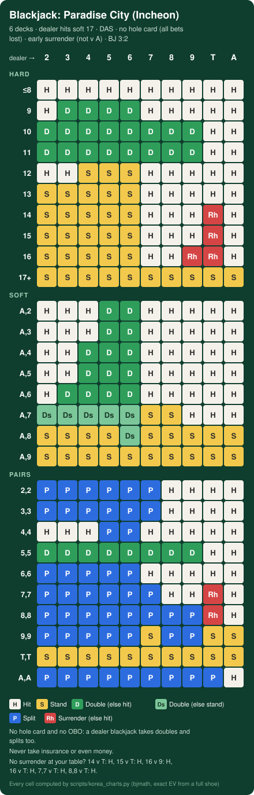
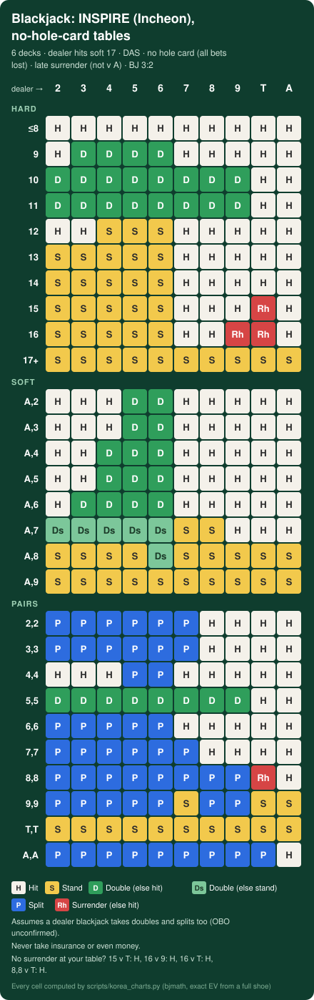
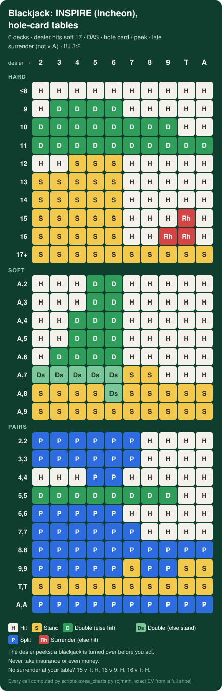
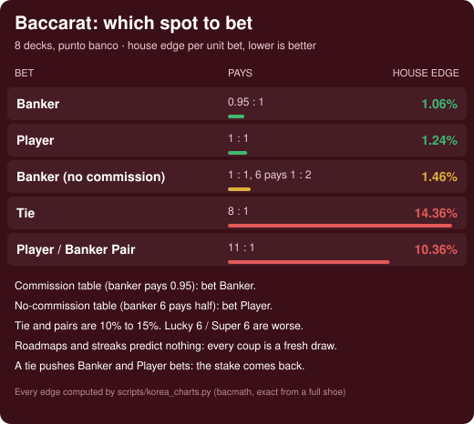

# 韓国カジノ (BJ / バカラ) 攻略メモ

2026-11-27 (金) の韓国行き用。仁川のパラダイスシティと INSPIRE を中心に、ソウル・釜山の外国人専用カジノもまとめた。調べたのは 2026-11-22。卓のルールは変わることがあるので、座る前に卓のプレートとモニターで確かめる。

戦略表の各マスは、`scripts/korea_charts.py` が各店のルールで期待値を計算して埋めた。どこかの表を写したものではない。

## まず結論: 勝つ確率を上げる方法

先に正直に書いておくと、BJ にもバカラにも、期待値がプラスになる賭け方はない。ここでいう「勝ち」は、**今回の旅でプラスのまま帰る確率を上げる**ことを指す。そのためにできるのは次の 5 つ。

1. **エッジの低い賭けしかしない**
   - BJ は下の表どおりに打つ。インシュアランスとサイドベットはやらない。
   - バカラは、コミッション卓ならバンカー、ノーコミッション卓ならプレイヤーに賭ける。
   - これだけでハウスエッジは約 1% になる。タイやペアは 10〜15% あるので、それに比べればずっとまし。
2. **打つ回数を減らす**
   - エッジは回数に比例して効いてくる。バカラで同じ額を賭け続けたときの、プラスで終わる確率 (8 デッキ、正確に計算した値) は次のとおり。

     | 回数 | プレイヤー (ノーコミ卓) | バンカー (コミッション卓) |
     |---|---|---|
     | 1 | 44.6% | 45.9% |
     | 10 | 41.2% | 44.5% |
     | 100 | 42.8% | 44.7% |
     | 300 | 39.9% | 42.2% |
     | 1000 | 33.5% | 35.8% |

   - 1 回だけ賭けて勝てる確率が 50% を切るのは、タイ (約 9.5%) が引き分けになるから。
   - 長く座るほど、プラスで帰れる確率は下がっていく。
3. **勝ち逃げと損切りの額を先に決める**
   - 例: 持ち金の +50% か -50% になったら席を立つ。
   - 取り返そうとしてベット額を上げるのはやめる。マーチンゲール (負けたら倍賭け) は、テーブル上限か資金のどちらかに先に当たって終わる。
4. **タダでもらえるものは全部もらう**
   - 新規会員クーポン、無料の食事とドリンク、ポイント。
   - 新規クーポンはセブンラックが 60,000 KRW (釜山は 30,000)。これは実質的にプラスの賭けになる。
5. **カードカウンティングはここでは効かない**
   - パラダイスシティと INSPIRE の BJ は全部 CSM (連続シャッフルマシン)。
   - 毎回カードが戻されるので、カウントが育たない。

## 店選び

| | パラダイスシティ | INSPIRE |
|---|---|---|
| 場所 | 仁川空港の近く | 仁川空港の近く (永宗島) |
| 行き方 | AREX で仁川空港 T1 へ。1F 3C 乗り場から無料シャトル (20 分おき、05:10〜23:10)。T1 の 14C 乗り場は廃止 | AREX で空港へ。無料シャトルは T1 線 (08:15〜22:15、1F 2C / 14C) と T2 線 (05:00〜23:00、1F 8A)。2026-11-01 から新しい時刻表 |
| BJ のミニマム | 30,000 KRW (10,000 の時期もあった) | 30,000 KRW (10,000 とする記事もある) |
| BJ のルール | ホールカードなし (ENHC)、OBO なし、6 デッキ、H17 (ブログ情報)、どの 2 枚でもダブル可、DAS、スプリットは 3 ハンドまで、アーリーサレンダー (A 相手は不可) | ホールカードなしの卓とホールカードありの卓がある。H17 (2025-04 から)、どの 2 枚でもダブル可、DAS、レイトサレンダー (A 相手は不可) |
| バカラ | 10,000〜50,000 の卓は全部ノーコミッション。コミッション卓は 100,000 から | メインフロアはノーコミッションだけ (ミニマム 50,000〜) |
| 日本語 | 日本人スタッフが常駐 (日の丸のピンバッジが目印) | 不明 |

### ソウル・釜山の店

| 店 | 場所 | 行き方 | ミニマムの目安 |
|---|---|---|---|
| セブンラック ソウルドラゴンシティ | 龍山 | 龍山駅 3 番出口から徒歩 1〜3 分。ソウル中心部から一番近い | BJ 10,000〜 / バカラ 50,000〜 |
| セブンラック 江南 COEX | 三成 | 奉恩寺駅 7 番出口 | BJ 10,000〜50,000 / バカラ 50,000 |
| パラダイス ウォーカーヒル | 広津区 | 江辺駅と広渡口駅から無料シャトル (06:00〜23:30) | BJ 50,000〜 (ソウルで一番高い) |
| セブンラック 釜山ロッテ | 西面 | 西面駅 7 番出口から徒歩 5 分 | 30,000〜 |

- セブンラックのヒルトン店は 2022 年末に閉店して、ドラゴンシティに移った。ヒルトン店が出てくる記事は古い。
- 11/27 は金曜。週末の夜はミニマムの安い卓から埋まっていくので、早めの時間に行くといい。
- ミニマムの数字はほとんどが代理店系サイトや口コミのもの。公式のリミット表は見つからなかった。

## ブラックジャック

色の意味:

- 白 H: ヒット
- 黄 S: スタンド
- 緑 D: ダブル (できなければヒット)
- 薄緑 Ds: ダブル (できなければスタンド)
- 青 P: スプリット
- 赤 Rh / Rs: サレンダー (できなければヒット / スタンド)

ハードは A を含まない手、ソフトは A を 11 と数えられる手。

### パラダイスシティ

### INSPIRE (ホールカードなしの卓)

### INSPIRE (ホールカードありの卓)

### ホールカードなし (ENHC) で一番大事なこと

- ディーラーは 2 枚目を伏せて配らない。BJ かどうかは、プレイヤーが全員動いた後にわかる。
- パラダイスシティは 2022-09 に OBO をやめた。ディーラーが BJ だと、**ダブルとスプリットで足した分まで全部取られる**。
- だからディーラーの T と A に対しては、強気の手を控える。
  - 11 対 T / A はダブルせずにヒット。
  - A,A 対 A はスプリットせずにヒット。
  - 8,8 対 A はスプリットしない。
- ディーラーが 2〜9 のときは、ふつうの表と同じ。
- インシュアランスとイーブンマネーは取らない。どちらも期待値はマイナス。

### サイドベットと変種

- **Free Bet BJ** (両店にある): ダブルとスプリットが無料になる代わりに、ディーラーの 22 は引き分けになる。ハウスエッジは約 1% で、ふつうの卓より悪い。
- **ペア (11 倍) とジャックポット**: どちらもエッジが大きいのでやらない。

## バカラ

- **コミッション卓 (バンカーの配当 0.95 倍)**: バンカーに賭ける。エッジは 1.06%。
- **ノーコミッション卓 (バンカーが 6 で勝つと半額)**: プレイヤーに賭ける。プレイヤーは 1.24%、バンカーは 1.46%。
  - パラダイスシティの安い卓と INSPIRE のメインフロアは全部ノーコミッションなので、ほとんどの場面でこちらになる。
- タイ (8 倍) は 14.36%、ペア (11 倍) は 10.36%。Lucky 6 / Super 6 はさらに悪い。
- 罫線 (ビッグロードなど) を見ても次の勝ちは予測できない。1 回ごとに新しくカードを引いているだけ。
- スクイーズ (カードをめくる演出) は、一番多く賭けた人がやる。他人のカードには触らない。

## 入場・会員カード・両替

- **入場**
  - パスポートの原本が必須 (コピーは不可)。19 歳以上の外国籍の人だけ入れる。24 時間営業で入場は無料。
- **服装**
  - セブンラックは、短パン・ジャージ・サンダルだと断られることがある。
  - パラダイスはドレスコードなし。
  - きれいめのカジュアルで行けばどこでも大丈夫。
- **会員カード**
  - 最初に無料で作る。打つたびにディーラーにカードを見せないとポイントがつかない。
  - セブンラックではプレイ実績に応じて約 4 時間ごとに食事券が出る。ドリンクは無料。
- **チップへの両替**
  - 卓で現金 (KRW) を出してチップに替えるか、場内のキャッシャーで替える。
  - 円をそのまま卓で使えるかは情報が割れているので、キャッシャーで KRW に替えてから座るのが確実。
- **レート**
  - 円→ウォンは明洞の両替所が一番いい。
  - ウォン→円もカジノよりは明洞のほうがいい (カジノの売値は INSPIRE 902、パラダイスシティ 905、ウォーカーヒル 911)。
  - ただし勝ち分を国外へ持ち出すなら、ケージで替えて証明書をもらうほうが安全 (次の節)。
- **AMEX**: INSPIRE では使えない (代理店サイトの情報)。

## お金と法律

- **韓国の税金**
  - テーブルゲームの勝ちに税金はかからず、源泉徴収もない。
  - 22% が源泉徴収されるのはスロットのジャックポット (1 回 200 万 KRW 超) だけ。当たったら源泉徴収の証明書をもらう。
- **韓国の税関**
  - 入国時に 1 万 USD 相当を超える外貨とウォンを持っていたら申告する。入国審査を抜けた後では「外貨申告確認書」をもらえない。
  - 出国時、カジノで再両替した勝ち分は、申告は要らないが証明が要る。**ケージで替えるたびに再両替証明書 (receipt) をもらって取っておく**。
- **日本の税関**
  - 現金・小切手などが 100 万円を超えるなら、出国時も入国時も「支払手段等の携帯輸出・輸入申告書」を出す。税金はかからない。
- **日本の法律と税金**
  - 海外の合法カジノで遊ぶのは賭博罪にならない (政府答弁書)。ただし日本からオンラインカジノに接続するのは違法。
  - 勝ち分は一時所得になる。50 万円を引いた残りの 1/2 が課税対象。
  - 負けは他の所得と相殺できない。
  - 会社員でカジノ以外の副収入がなければ、利益が 90 万円までなら申告しなくていい計算になる。

## マナーと安全

- **撮影**: フロアでの写真・動画撮影は全面禁止。隠し撮りが見つかると退場させられ、出禁になることもある。
- **スマホ**: 卓では通話も長い操作もしない。
- **チップを触るタイミング**: 自分のチップを動かすのは、前の勝負の精算が終わってから。
- **BJ の手の合図**
  - ヒット: 卓を指でトントン叩く。
  - スタンド: 手のひらを横に振る。
- **ディーラーへのチップ**: 任意。大きく勝ったときに少し置くくらいでいい。
- **関わらない相手**
  - 「無料ツアー」やジャンケットの客引き、見知らぬ人が持ちかける必勝法やサインのやりとり。
  - 負けを取り返すための借金の勧誘。
- **移動**: カジノ周辺の白タクやコールバンには乗らず、表示のある正規のタクシーを使う。
- **偽サイト**: 「韓国カジノ公式」を名乗るオンラインカジノの勧誘は詐欺。
- **相談先**
  - 韓国: 1336 (KCGP)
  - 日本: こころの健康相談統一ダイヤル 0570-064-556、各地の精神保健福祉センター

## 当日のチェックリスト

- [ ] パスポートの原本
- [ ] 使う上限額だけを現金で持つ。ATM とキャッシングは使わない
- [ ] 入国時の現金が 1 万 USD / 100 万円を超えるなら申告する
- [ ] 会員カードを作って、新規クーポンをもらう
- [ ] BJ は座る前にプレートで確かめる: ホールカードの有無、S17 か H17 か、サレンダーの有無
- [ ] バカラは、コミッション卓ならバンカー、ノーコミッション卓ならプレイヤー
- [ ] 勝ち逃げと損切りの額を決めて、どちらかに届いたら席を立つ
- [ ] 勝ち分をケージで替えたら証明書をもらう
- [ ] シャトルの終発: パラダイスシティは 23:10、INSPIRE の T1 線は 22:15

## 確かめきれなかったこと

- **パラダイスシティの BJ**
  - H17 はブログ 2 件の情報。公式ページには書いていない。卓が S17 なら、表のごく一部が変わる。
  - サレンダーがアーリー (ディーラーの BJ に関係なく半額戻る) だという情報は 2017 年のもの。レイトだった場合は、表の 14 対 T と 7,7 対 T がヒットになる (INSPIRE のホールカードなしの表と同じ形)。
- **INSPIRE**
  - 公式のルールページがない。
  - デッキ数、ホールカードなし卓の OBO の有無、リスプリットの上限は未確認。表は 6 デッキ・OBO なしで計算した。
- **ミニマムと両替手数料**: 情報源によって違う。現地で確かめる。

## 出典

調べたのは 2026-11-22。

- 公式
  - [Paradise City Game Guide](https://www.p-city.com/front/casino/gameGuide/?language=JA)
  - [Paradise Casino Beginners Guide](https://www.paradisecasino.co.kr/mobile/casino-guide/beginners?lang=en)
  - [INSPIRE Getting Here](https://www.inspireresorts.com/en/about-us/getting-here)
  - [セブンラック 入場案内](https://m.7luck.com/kr/GUID_01_01)
  - [Walkerhill Directions](https://www.walkerhill.com/grandwalkerhillseoul/en/Map?tabIdx=2)
- ルール (ブログ・口コミ)
  - [resocasi: パラダイスシティ OBO 廃止 (2022)](https://www.resocasi.com/casinoinfo/bbs-details/?id=3122)
  - [resocasi: 6 デッキ・ジャックポット (2025-26)](https://www.resocasi.com/bbs/bbs-details/?id=3475)
  - [casino-traveller: パラダイスシティ](https://casino-traveller.com/casino-report/korea-41/)
  - [casino-traveller: INSPIRE](https://casino-traveller.com/casino-report/korea-30/)
  - [hayapenguin (2017)](https://hayapenguin.com/articles/seoul-casino-trip-2)
  - [note: INSPIRE](https://note.com/lamborghini_tyo/n/nff9216b7ee5b)
  - [ameblo: Free Bet 比較](https://ameblo.jp/nesta0616/entry-12875278778.html)
  - [GGRAsia: INSPIRE のバカラのミニマム](https://www.ggrasia.com/inspire-mass-baccarat-bets-start-circa-macau-level-says-exec/)
- 照合した計算
  - [Wizard of Odds: ENHC 6D H17 の期待値表](https://wizardofodds.com/games/blackjack/appendix/9/euro-6dh17r4/)
  - [Wizard of Odds: Baccarat](https://wizardofodds.com/games/baccarat/basics/)
- 店舗・ミニマム
  - [korecasi-vip: 韓国 BJ](https://korecasi-vip.jp/blog/koreacasino-blackjack/)
  - [korecasi-vip: セブンラック](https://korecasi-vip.jp/blog/koreacasino-sevenluckcasino/)
  - [konest: パラダイスシティ](https://www.konest.com/contents/spot_mise_detail.html?id=18346)
  - [ktriptips: セブンラック COEX](https://www.ktriptips.com/kor/leisure/131903)
  - [Asia Business Daily: セブンラックの移転](https://view.asiae.co.kr/en/article/2022123013271082423)
- お金と法律
  - [韓国関税庁: 外貨の申告](https://www.customs.go.kr/english/cm/cntnts/cntntsView.do?mi=10800&cntntsId=5500)
  - [韓国関税庁: 出国時の扱い](https://www.customs.go.kr/kcs/cm/cntnts/cntntsView.do?mi=8458&cntntsId=2808)
  - [日本の税関: 支払手段等の携帯輸出・輸入](https://www.customs.go.jp/kaigairyoko/shiharaishudan.htm)
  - [国税庁 No.1490 一時所得](https://www.nta.go.jp/taxes/shiraberu/taxanswer/shotoku/1490.htm)
  - [国税庁 No.2250 損益通算](https://www.nta.go.jp/taxes/shiraberu/taxanswer/shotoku/2250.htm)
  - [衆議院 質問主意書 (海外カジノと賭博罪)](https://www.shugiin.go.jp/internet/itdb_shitsumon.nsf/html/shitsumon/a185017.htm)
  - [日韓租税条約](https://worldjpn.net/documents/texts/JPKR/19981008.T1J.html)
  - [resocasi: カジノの換金レート](https://www.resocasi.com/report/report-details/?id=2592)
  - [KCGP 1336](https://www.kcgp.or.kr/portal/main/contents.do?menuNo=200062)
